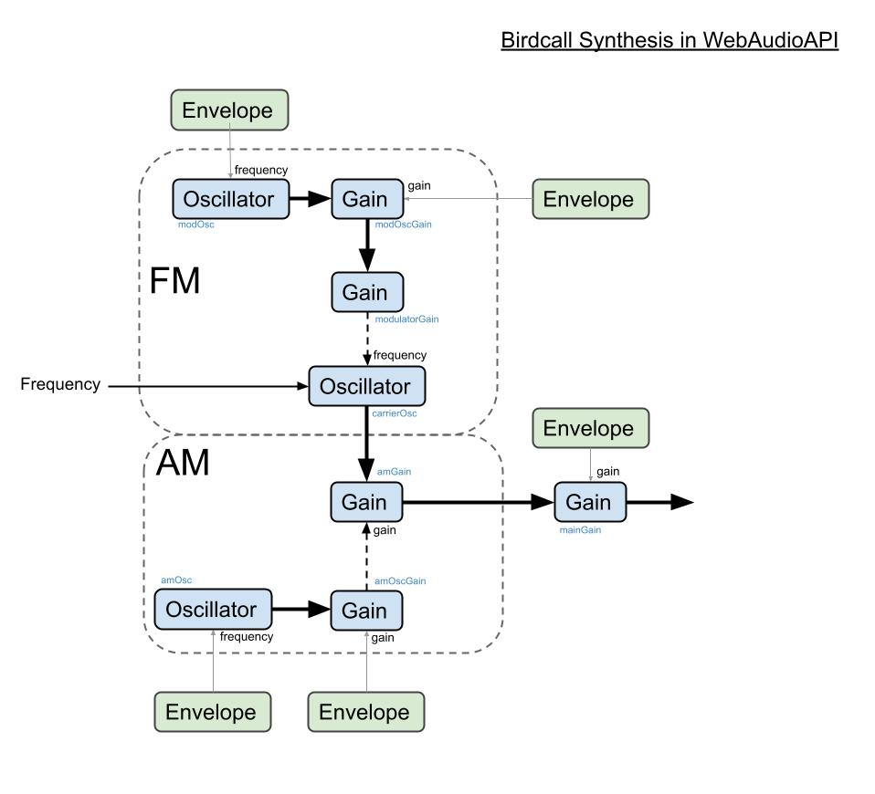

birds
=====

This is a completely Google - Antigravity/Gemini created port of the original project by [nottheup](https://github.com/notthetup/birds).

In short, it makes bird noises.

I really don't love AI, but doing this little vibe-coding exercise has helped me understand the current capabilities and limitations of these tools, which is to say, it shit this out in 15 minutes when it wolud've taken me multiple days to make something with this nice of a UI, and it ported the actual DSP in under 10 seconds. Weird.

---

Original Readme:

## What ?

WebAudioAPI based Birdcall Synthesis based on AM+FM using ideas from  [Start from Birdcall synthesis - Andy Farrell](http://obiwannabe.co.uk/tutorials/html/tutorial_birds.html).

Here is a brief overview of the structure of the connections.

## Where ?

Play with the model [here](http://notthetup.github.io/birds). Only works on Chrome and Safari for now. FF has some funky bugs.

## Why ?

Because birds!

## How ?

1. Magic
2. [WebAudioAPI](http://webaudio.github.io/web-audio-api/)
3. [Synthesis](https://ccrma.stanford.edu/software/snd/snd/fm.html)
